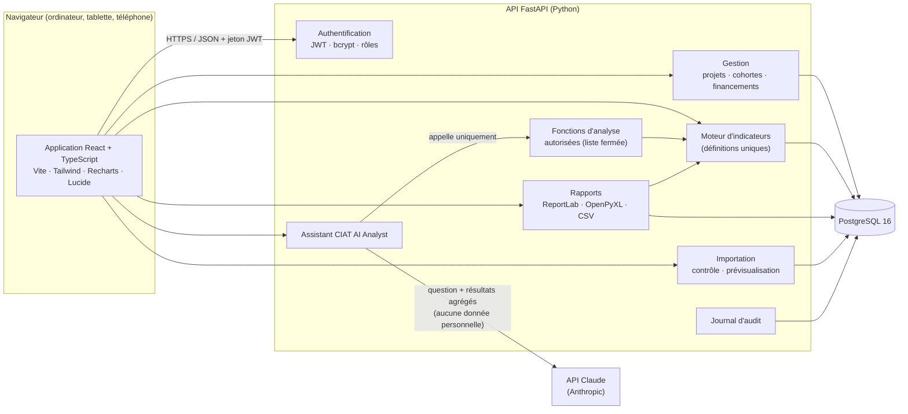
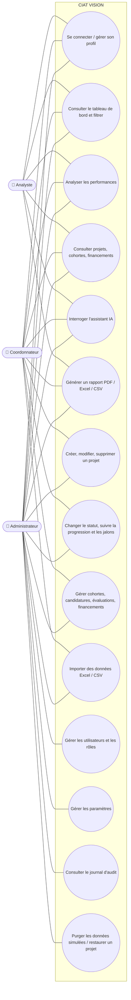
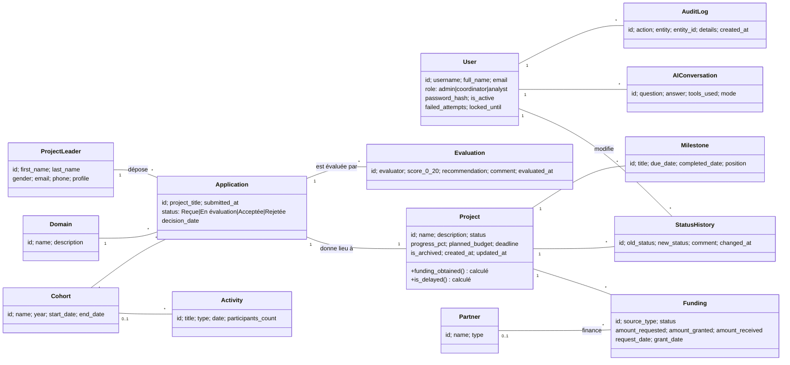
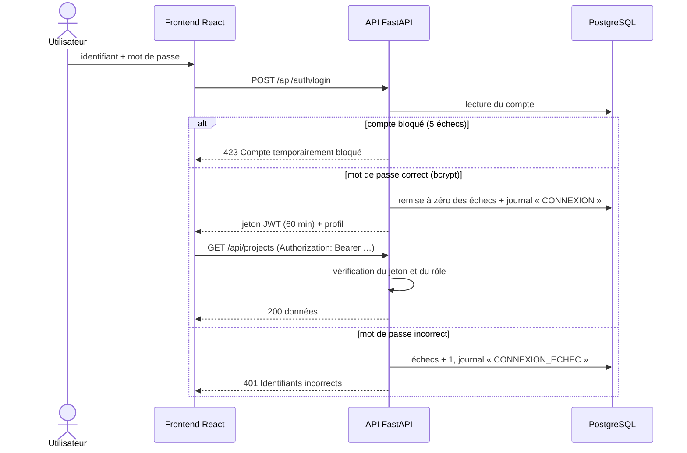
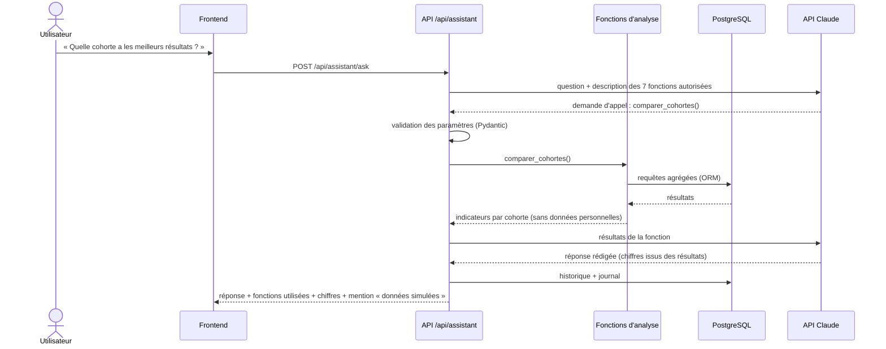
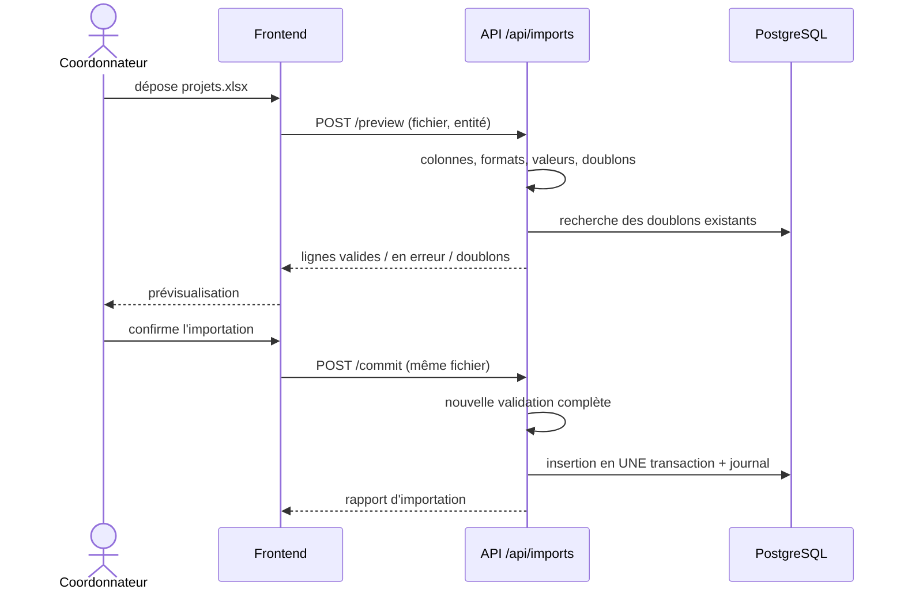
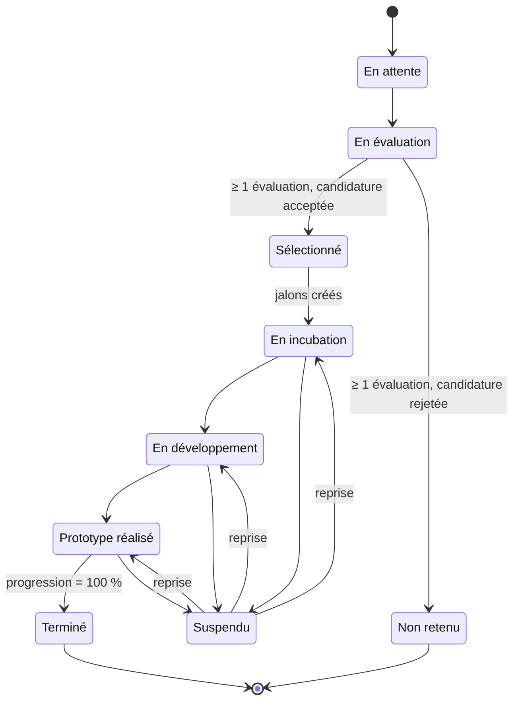
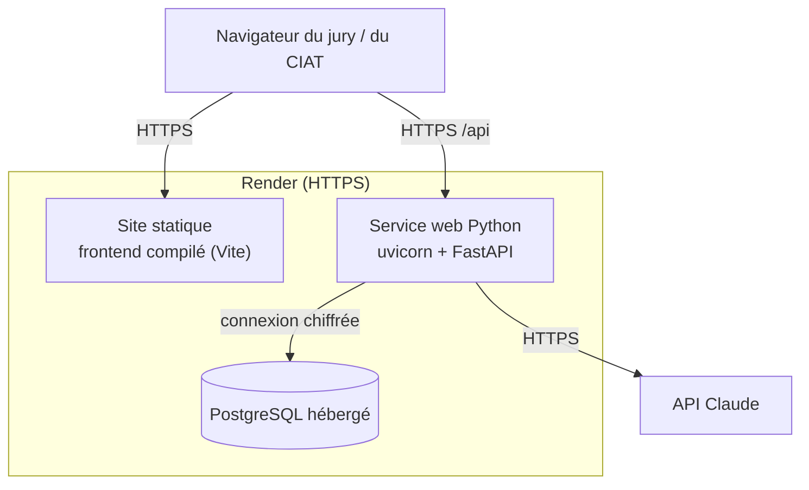

# Phase 2 – Architecture logicielle et diagrammes UML

**Objectif de la phase :** définir l'organisation du code, les composants, leurs échanges et les principaux
scénarios avant d'écrire la moindre ligne de code.

Les diagrammes sont écrits en Mermaid : ils s'affichent directement dans GitHub, GitLab et VS Code
(extension « Markdown Preview Mermaid Support »).

---

## 1. Vue d'ensemble



Principes :
1. **Le frontend n'affiche que ce que l'API renvoie** : aucune statistique n'est codée ou calculée dans l'interface.
2. **Une seule définition par indicateur** (`app/kpi.py`), utilisée par le tableau de bord, les rapports et l'IA.
3. **L'IA n'accède jamais à la base** : elle choisit des fonctions d'analyse ; le backend les exécute.
4. **Les droits sont vérifiés côté serveur** sur chaque route (dépendance FastAPI `require_roles`).

---

## 2. Organisation du code

```
CIAT_VISION/
├── backend/
│   ├── app/
│   │   ├── main.py            Application FastAPI, CORS, gestion des erreurs, routes
│   │   ├── config.py          Paramètres lus dans les variables d'environnement
│   │   ├── database.py        Connexion SQLAlchemy, session par requête
│   │   ├── models.py          Tables (SQLAlchemy 2)
│   │   ├── schemas.py         Schémas d'entrée/sortie (Pydantic 2)
│   │   ├── security.py        Hachage bcrypt, JWT, contrôle des rôles
│   │   ├── constants.py       Statuts, transitions autorisées, rôles
│   │   ├── services/          Règles métier (projets, KPI, analyses, IA, rapports, import, audit)
│   │   ├── routers/           Une route par module (auth, projects, cohorts, fundings…)
│   │   ├── seed.py            Génération des données SIMULÉES
│   │   └── assets/            Logo utilisé dans les PDF
│   ├── alembic/               Migrations du schéma
│   ├── tests/                 Tests pytest
│   └── requirements.txt
├── frontend/
│   ├── src/
│   │   ├── api/               Client HTTP typé
│   │   ├── auth/              Contexte d'authentification, garde de routes
│   │   ├── components/        Composants réutilisables (cartes KPI, filtres, tableaux, modales…)
│   │   ├── pages/             Une page par module
│   │   └── lib/               Formatage, couleurs, permissions
│   └── package.json
├── docs/                      Livrables (cahier des charges, architecture, base, maquettes, guides, rapport)
├── docker-compose.yml         PostgreSQL local
└── render.yaml                Déploiement Render
```

---

## 3. Diagramme de cas d'utilisation



---

## 4. Diagramme de classes (modèle métier)



---

## 5. Diagrammes de séquence

### 5.1. Connexion et appel protégé


### 5.2. Question posée à l'assistant IA

Sans clé d'API, l'étape « API Claude » est remplacée par une **reconnaissance de mots-clés** qui appelle
directement la fonction d'analyse correspondante (mode dégradé).

### 5.3. Importation d'un fichier


---

## 6. Diagramme d'états d'un projet


La suspension n'est possible qu'à partir de « En incubation » : un projet suspendu est donc toujours un projet
incubé, ce qui rend le taux d'achèvement sans ambiguïté.

---

## 7. Diagramme de déploiement


Variables d'environnement du service web : `DATABASE_URL`, `JWT_SECRET`, `ANTHROPIC_API_KEY` (facultative),
`CORS_ORIGINS`. Aucune n'est écrite dans le code.

---

## 8. Choix techniques justifiés

| Choix | Justification |
|---|---|
| FastAPI | Validation automatique (Pydantic), documentation OpenAPI générée (`/docs`), performances |
| SQLAlchemy 2 + Alembic | Requêtes paramétrées (anti-injection), migrations versionnées |
| PostgreSQL | Contraintes d'intégrité riches, agrégations rapides, hébergement disponible sur Render |
| JWT sans état | Pas de session serveur à stocker ; durée limitée ; renouvellement par `/api/auth/refresh` |
| Jeton en `sessionStorage` | Effacé à la fermeture de l'onglet ; l'application n'insère jamais de HTML non échappé (React) |
| Appel d'outils pour l'IA | Le modèle ne peut que choisir des fonctions validées : pas de SQL généré, chiffres traçables |
| ReportLab (graphiques intégrés) | PDF vectoriels sans dépendance graphique lourde |
| Recharts | Graphiques React déclaratifs, interactifs, responsives |
