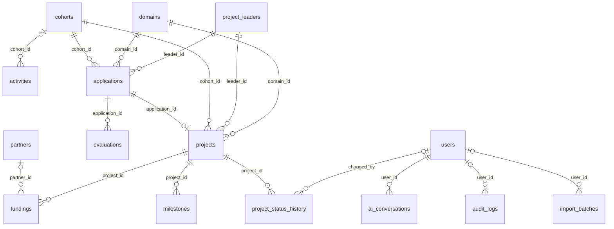

# Phase 3 – Base de données PostgreSQL et dictionnaire des données

**Objectif de la phase :** modéliser des données structurées, cohérentes et protégées par des contraintes.

> Document **généré automatiquement** à partir du code (`backend/scripts/generer_dictionnaire.py`) : il reflète exactement le schéma réel. Le schéma est créé par la migration Alembic `backend/alembic/versions/*_schema_initial_ciat_vision.py`.

## 1. Modèle conceptuel (diagramme entité-association)



## 2. Conventions

- Clé primaire `id` (entier auto-incrémenté) sur toutes les tables (sauf `settings` : clé texte).
- `created_at` / `updated_at` renseignés automatiquement par PostgreSQL.
- `is_simulated` sur les tables métier : identifie les données de démonstration (purge en un clic).
- Montants en **FCFA** (entiers 64 bits), dates au format ISO.
- Les valeurs autorisées (statuts, rôles, montants, ordre des dates) sont contrôlées **en base** par des contraintes `CHECK`, en plus de la validation Pydantic de l'API : une donnée incohérente ne peut pas être enregistrée, même par un script.
- Suppression des projets : **logique** (`is_archived`), pour préserver l'historique.

## 3. Dictionnaire des données

### `cohorts`

Promotions annuelles d'incubation.

| Colonne | Type | Obligatoire | Clé | Description |
|---|---|:-:|---|---|
| `id` | entier | oui | PK | Identifiant unique (clé primaire, auto-incrémentée). |
| `name` | texte (60) | oui | unique | Nom de la cohorte (unique), ex. « Cohorte 2026 ». |
| `year` | entier | oui |  | Année de la cohorte. |
| `start_date` | DATE | oui |  | Début de l'incubation. |
| `end_date` | DATE | oui |  | Fin de l'incubation (postérieure au début). |
| `description` | TEXT | non |  | Description libre. |
| `created_at` | DATETIME | oui |  | Date et heure de création (automatique). |
| `updated_at` | DATETIME | oui |  | Date et heure de dernière modification (automatique). |
| `is_simulated` | BOOLEAN | oui |  | Vrai pour les données de démonstration SIMULÉES (purgeables par l'administrateur). |

Contraintes :
- `ck_cohorts_year` : `year BETWEEN 2000 AND 2100`
- `ck_cohorts_dates` : `end_date > start_date`

Index : `ix_cohorts_is_simulated` (is_simulated)

### `domains`

Domaines d'activité des projets (référentiel).

| Colonne | Type | Obligatoire | Clé | Description |
|---|---|:-:|---|---|
| `id` | entier | oui | PK | Identifiant unique (clé primaire, auto-incrémentée). |
| `name` | texte (100) | oui | unique | Nom du domaine (unique). |
| `description` | TEXT | non |  | Description du domaine. |
| `created_at` | DATETIME | oui |  | Date et heure de création (automatique). |
| `updated_at` | DATETIME | oui |  | Date et heure de dernière modification (automatique). |

### `partners`

Partenaires et bailleurs du CIAT.

| Colonne | Type | Obligatoire | Clé | Description |
|---|---|:-:|---|---|
| `id` | entier | oui | PK | Identifiant unique (clé primaire, auto-incrémentée). |
| `name` | texte (120) | oui | unique | Nom du partenaire (unique). |
| `type` | texte (20) | oui |  | Technique, Financier, Institutionnel, Académique ou Commercial. |
| `contact_email` | texte (120) | non |  | E-mail de contact. |
| `created_at` | DATETIME | oui |  | Date et heure de création (automatique). |
| `updated_at` | DATETIME | oui |  | Date et heure de dernière modification (automatique). |
| `is_simulated` | BOOLEAN | oui |  | Vrai pour les données de démonstration SIMULÉES (purgeables par l'administrateur). |

Contraintes :
- `ck_partners_type` : `type IN ('Technique', 'Financier', 'Institutionnel', 'Académique', 'Commercial')`

Index : `ix_partners_is_simulated` (is_simulated)

### `project_leaders`

Porteurs de projet. **Données personnelles** : jamais transmises à l'IA ; coordonnées masquées pour le rôle Analyste.

| Colonne | Type | Obligatoire | Clé | Description |
|---|---|:-:|---|---|
| `id` | entier | oui | PK | Identifiant unique (clé primaire, auto-incrémentée). |
| `first_name` | texte (60) | oui |  | Prénom du porteur. |
| `last_name` | texte (60) | oui |  | Nom du porteur. |
| `gender` | texte (10) | non |  | Femme, Homme ou non renseigné. |
| `email` | texte (120) | non |  | E-mail du porteur (donnée personnelle). |
| `phone` | texte (30) | non |  | Téléphone du porteur (donnée personnelle). |
| `profile` | texte (30) | oui |  | Étudiant ISEP, Diplômé ISEP ou Externe. |
| `created_at` | DATETIME | oui |  | Date et heure de création (automatique). |
| `updated_at` | DATETIME | oui |  | Date et heure de dernière modification (automatique). |
| `is_simulated` | BOOLEAN | oui |  | Vrai pour les données de démonstration SIMULÉES (purgeables par l'administrateur). |

Contraintes :
- `ck_leaders_profile` : `profile IN ('Étudiant ISEP', 'Diplômé ISEP', 'Externe')`
- `ck_leaders_gender` : `gender IN ('Femme', 'Homme') OR gender IS NULL`

Index : `ix_project_leaders_is_simulated` (is_simulated)

### `settings`

Paramètres modifiables par l'administrateur (clé / valeur).

| Colonne | Type | Obligatoire | Clé | Description |
|---|---|:-:|---|---|
| `key` | texte (50) | oui | PK | Nom du paramètre (clé primaire). |
| `value` | texte (500) | oui |  | Valeur du paramètre. |
| `updated_at` | DATETIME | oui |  | Date et heure de dernière modification (automatique). |

### `users`

Comptes des utilisateurs de la plateforme et leur rôle.

| Colonne | Type | Obligatoire | Clé | Description |
|---|---|:-:|---|---|
| `id` | entier | oui | PK | Identifiant unique (clé primaire, auto-incrémentée). |
| `username` | texte (30) | oui | unique | Identifiant de connexion (unique, 3 à 30 caractères). |
| `full_name` | texte (100) | oui |  | Nom complet affiché. |
| `email` | texte (120) | non |  | Adresse e-mail professionnelle. |
| `role` | texte (20) | oui |  | Rôle : admin, coordinator ou analyst (matrice des droits § 4.2 du cahier des charges). |
| `password_hash` | texte (100) | oui |  | Hachage bcrypt du mot de passe (le mot de passe n'est jamais stocké). |
| `is_active` | BOOLEAN | oui |  | Compte actif (un compte désactivé ne peut plus se connecter). |
| `failed_attempts` | entier | oui |  | Nombre d'échecs de connexion consécutifs. |
| `locked_until` | DATETIME | non |  | Fin du blocage temporaire après 5 échecs. |
| `last_login_at` | DATETIME | non |  | Date de la dernière connexion réussie. |
| `created_at` | DATETIME | oui |  | Date et heure de création (automatique). |
| `updated_at` | DATETIME | oui |  | Date et heure de dernière modification (automatique). |

Contraintes :
- `ck_users_role` : `role IN ('admin', 'coordinator', 'analyst')`

### `activities`

Activités du CIAT : formations, ateliers, événements, mentorat.

| Colonne | Type | Obligatoire | Clé | Description |
|---|---|:-:|---|---|
| `id` | entier | oui | PK | Identifiant unique (clé primaire, auto-incrémentée). |
| `title` | texte (150) | oui |  | Intitulé de l'activité. |
| `type` | texte (20) | oui |  | Formation, Atelier, Événement ou Mentorat. |
| `activity_date` | DATE | oui |  | Date de l'activité. |
| `cohort_id` | entier | non | FK → `cohorts` (SET NULL) | Cohorte concernée (facultatif). |
| `participants_count` | entier | oui |  | Nombre de participants. |
| `description` | TEXT | non |  | Description. |
| `created_at` | DATETIME | oui |  | Date et heure de création (automatique). |
| `updated_at` | DATETIME | oui |  | Date et heure de dernière modification (automatique). |
| `is_simulated` | BOOLEAN | oui |  | Vrai pour les données de démonstration SIMULÉES (purgeables par l'administrateur). |

Contraintes :
- `ck_activities_type` : `type IN ('Formation', 'Atelier', 'Événement', 'Mentorat')`
- `ck_activities_participants` : `participants_count >= 0`

Index : `ix_activities_is_simulated` (is_simulated), `ix_activities_activity_date` (activity_date)

### `ai_conversations`

Historique des questions posées à l'assistant IA.

| Colonne | Type | Obligatoire | Clé | Description |
|---|---|:-:|---|---|
| `id` | entier | oui | PK | Identifiant unique (clé primaire, auto-incrémentée). |
| `user_id` | entier | oui | FK → `users` (CASCADE) | Utilisateur ayant posé la question. |
| `question` | TEXT | oui |  | Question posée. |
| `answer` | TEXT | oui |  | Réponse fournie. |
| `tools_used` | JSON | non |  | Fonctions d'analyse appelées, paramètres et résultats (JSON). |
| `mode` | texte (20) | oui |  | IA (Claude) ou dégradé (sans IA générative). |
| `created_at` | DATETIME | oui |  | Date et heure de création (automatique). |

Index : `ix_ai_conversations_created_at` (created_at), `ix_ai_conversations_user_id` (user_id)

### `applications`

Candidatures déposées par les porteurs pour une cohorte.

| Colonne | Type | Obligatoire | Clé | Description |
|---|---|:-:|---|---|
| `id` | entier | oui | PK | Identifiant unique (clé primaire, auto-incrémentée). |
| `leader_id` | entier | oui | FK → `project_leaders` (RESTRICT) | Porteur ayant déposé la candidature. |
| `cohort_id` | entier | oui | FK → `cohorts` (RESTRICT) | Cohorte visée. |
| `domain_id` | entier | oui | FK → `domains` (RESTRICT) | Domaine du projet proposé. |
| `project_title` | texte (150) | oui |  | Intitulé du projet proposé. |
| `submitted_at` | DATE | oui |  | Date de dépôt (sert au filtre « période »). |
| `status` | texte (20) | oui |  | Reçue, En évaluation, Acceptée ou Rejetée. |
| `decision_date` | DATE | non |  | Date de la décision du comité. |
| `created_at` | DATETIME | oui |  | Date et heure de création (automatique). |
| `updated_at` | DATETIME | oui |  | Date et heure de dernière modification (automatique). |
| `is_simulated` | BOOLEAN | oui |  | Vrai pour les données de démonstration SIMULÉES (purgeables par l'administrateur). |

Contraintes :
- `ck_applications_status` : `status IN ('Reçue', 'En évaluation', 'Acceptée', 'Rejetée')`
- `ck_applications_dates` : `decision_date IS NULL OR decision_date >= submitted_at`

Index : `ix_applications_leader_id` (leader_id), `ix_applications_is_simulated` (is_simulated), `ix_applications_cohort_domain` (cohort_id, domain_id), `ix_applications_submitted_at` (submitted_at)

### `audit_logs`

Journal d'audit : connexions, modifications, exports, imports, changements de droits.

| Colonne | Type | Obligatoire | Clé | Description |
|---|---|:-:|---|---|
| `id` | entier | oui | PK | Identifiant unique (clé primaire, auto-incrémentée). |
| `user_id` | entier | non | FK → `users` (SET NULL) | Utilisateur auteur de l'action. |
| `username` | texte (30) | non |  | Identifiant (conservé même si le compte est supprimé, ou tenté si inconnu). |
| `action` | texte (40) | oui |  | Code de l'action (CONNEXION, CREATION_PROJET, EXPORT_RAPPORT, IMPORT…). |
| `entity` | texte (40) | non |  | Type d'objet concerné. |
| `entity_id` | entier | non |  | Identifiant de l'objet concerné. |
| `details` | TEXT | non |  | Détails lisibles de l'action. |
| `ip_address` | texte (45) | non |  | Adresse IP de l'utilisateur. |
| `created_at` | DATETIME | oui |  | Date et heure de création (automatique). |

Index : `ix_audit_logs_user_id` (user_id), `ix_audit_logs_created_at` (created_at), `ix_audit_logs_action` (action)

### `import_batches`

Traçabilité des importations de fichiers.

| Colonne | Type | Obligatoire | Clé | Description |
|---|---|:-:|---|---|
| `id` | entier | oui | PK | Identifiant unique (clé primaire, auto-incrémentée). |
| `user_id` | entier | non | FK → `users` (SET NULL) | Auteur de l'importation. |
| `entity` | texte (30) | oui |  | Type de données importées (projects, fundings, cohorts). |
| `filename` | texte (200) | oui |  | Nom du fichier importé. |
| `rows_imported` | entier | oui |  | Lignes enregistrées. |
| `rows_skipped` | entier | oui |  | Lignes ignorées (erreurs, doublons). |
| `created_at` | DATETIME | oui |  | Date et heure de création (automatique). |

### `evaluations`

Évaluations des candidatures par le comité de sélection.

| Colonne | Type | Obligatoire | Clé | Description |
|---|---|:-:|---|---|
| `id` | entier | oui | PK | Identifiant unique (clé primaire, auto-incrémentée). |
| `application_id` | entier | oui | FK → `applications` (CASCADE) | Candidature évaluée. |
| `evaluator` | texte (100) | oui |  | Membre du comité ou expert. |
| `score` | NUMERIC(4, 2) | oui |  | Note sur 20. |
| `recommendation` | texte (20) | oui |  | Favorable, Réservé ou Défavorable. |
| `comment` | TEXT | non |  | Commentaire de l'évaluateur. |
| `evaluated_at` | DATE | oui |  | Date de l'évaluation (antérieure à la décision). |
| `created_at` | DATETIME | oui |  | Date et heure de création (automatique). |
| `updated_at` | DATETIME | oui |  | Date et heure de dernière modification (automatique). |
| `is_simulated` | BOOLEAN | oui |  | Vrai pour les données de démonstration SIMULÉES (purgeables par l'administrateur). |

Contraintes :
- `ck_evaluations_reco` : `recommendation IN ('Favorable', 'Réservé', 'Défavorable')`
- `ck_evaluations_score` : `score BETWEEN 0 AND 20`

Index : `ix_evaluations_application_id` (application_id), `ix_evaluations_is_simulated` (is_simulated)

### `projects`

Projets accompagnés (un projet par candidature).

| Colonne | Type | Obligatoire | Clé | Description |
|---|---|:-:|---|---|
| `id` | entier | oui | PK | Identifiant unique (clé primaire, auto-incrémentée). |
| `application_id` | entier | oui | FK → `applications` (RESTRICT) · unique | Candidature d'origine (relation 1-1). |
| `name` | texte (150) | oui |  | Nom du projet (unique au sein d'une cohorte). |
| `description` | TEXT | non |  | Description du projet. |
| `leader_id` | entier | oui | FK → `project_leaders` (RESTRICT) | Porteur du projet. |
| `domain_id` | entier | oui | FK → `domains` (RESTRICT) | Domaine d'activité. |
| `cohort_id` | entier | oui | FK → `cohorts` (RESTRICT) | Cohorte. |
| `status` | texte (25) | oui |  | Statut (cycle de vie § 5.2) : En attente … Terminé, Suspendu, Non retenu. |
| `progress_pct` | entier | oui |  | Progression de 0 à 100 % (100 % obligatoire si Terminé). |
| `planned_budget` | BIGINT | oui |  | Budget prévisionnel en FCFA. |
| `deadline` | DATE | non |  | Date limite du projet (sert au calcul des retards). |
| `is_archived` | BOOLEAN | oui |  | Suppression logique : le projet est exclu des listes et des indicateurs. |
| `archived_at` | DATETIME | non |  | Date de la suppression logique. |
| `created_at` | DATETIME | oui |  | Date et heure de création (automatique). |
| `updated_at` | DATETIME | oui |  | Date et heure de dernière modification (automatique). |
| `is_simulated` | BOOLEAN | oui |  | Vrai pour les données de démonstration SIMULÉES (purgeables par l'administrateur). |

Contraintes :
- `ck_projects_progress` : `progress_pct BETWEEN 0 AND 100`
- `ck_projects_completed_100` : `status <> 'Terminé' OR progress_pct = 100`
- `ck_projects_status` : `status IN ('En attente', 'En évaluation', 'Non retenu', 'Sélectionné', 'En incubation', 'En développement', 'Prototype réalisé', 'Terminé', 'Suspendu')`
- `ck_projects_budget` : `planned_budget >= 0`

Index : `ix_projects_active` (is_archived, status), `ix_projects_leader_id` (leader_id), `ix_projects_filters` (cohort_id, domain_id, status), `ix_projects_is_simulated` (is_simulated)

### `fundings`

Financements demandés, accordés et reçus par les projets.

| Colonne | Type | Obligatoire | Clé | Description |
|---|---|:-:|---|---|
| `id` | entier | oui | PK | Identifiant unique (clé primaire, auto-incrémentée). |
| `project_id` | entier | oui | FK → `projects` (CASCADE) | Projet financé. |
| `partner_id` | entier | non | FK → `partners` (SET NULL) | Partenaire / bailleur (facultatif). |
| `source_type` | texte (30) | oui |  | Subvention, Prêt d'honneur, Prix de concours, Investisseur, Fonds propres ou Partenaire. |
| `amount_requested` | BIGINT | oui |  | Montant demandé (FCFA). |
| `amount_granted` | BIGINT | oui |  | Montant accordé (FCFA) ≤ demandé. |
| `amount_received` | BIGINT | oui |  | Montant effectivement reçu (FCFA) ≤ accordé. |
| `request_date` | DATE | oui |  | Date de la demande. |
| `grant_date` | DATE | non |  | Date de l'accord (≥ date de demande). |
| `status` | texte (25) | oui |  | Demandé, Accordé, Partiellement reçu, Reçu ou Refusé (cohérent avec les montants). |
| `notes` | TEXT | non |  | Remarques. |
| `created_at` | DATETIME | oui |  | Date et heure de création (automatique). |
| `updated_at` | DATETIME | oui |  | Date et heure de dernière modification (automatique). |
| `is_simulated` | BOOLEAN | oui |  | Vrai pour les données de démonstration SIMULÉES (purgeables par l'administrateur). |

Contraintes :
- `ck_fundings_source` : `source_type IN ('Subvention', 'Prêt d''honneur', 'Prix de concours', 'Investisseur', 'Fonds propres', 'Partenaire')`
- `ck_fundings_order` : `amount_received <= amount_granted AND amount_granted <= amount_requested`
- `ck_fundings_status` : `status IN ('Demandé', 'Accordé', 'Partiellement reçu', 'Reçu', 'Refusé')`
- `ck_fundings_positive` : `amount_requested >= 0 AND amount_granted >= 0 AND amount_received >= 0`
- `ck_fundings_dates` : `grant_date IS NULL OR grant_date >= request_date`

Index : `ix_fundings_is_simulated` (is_simulated), `ix_fundings_partner_id` (partner_id), `ix_fundings_project_id` (project_id)

### `milestones`

Jalons (étapes) de chaque projet incubé.

| Colonne | Type | Obligatoire | Clé | Description |
|---|---|:-:|---|---|
| `id` | entier | oui | PK | Identifiant unique (clé primaire, auto-incrémentée). |
| `project_id` | entier | oui | FK → `projects` (CASCADE) | Projet concerné. |
| `title` | texte (100) | oui |  | Intitulé du jalon. |
| `position` | entier | oui |  | Ordre du jalon. |
| `due_date` | DATE | oui |  | Date prévue. |
| `completed_date` | DATE | non |  | Date réelle d'atteinte (vide = non atteint ; jamais dans le futur). |
| `created_at` | DATETIME | oui |  | Date et heure de création (automatique). |
| `updated_at` | DATETIME | oui |  | Date et heure de dernière modification (automatique). |
| `is_simulated` | BOOLEAN | oui |  | Vrai pour les données de démonstration SIMULÉES (purgeables par l'administrateur). |

Index : `ix_milestones_is_simulated` (is_simulated), `ix_milestones_open` (project_id, completed_date, due_date)

### `project_status_history`

Historique des changements de statut (traçabilité).

| Colonne | Type | Obligatoire | Clé | Description |
|---|---|:-:|---|---|
| `id` | entier | oui | PK | Identifiant unique (clé primaire, auto-incrémentée). |
| `project_id` | entier | oui | FK → `projects` (CASCADE) | Projet concerné. |
| `old_status` | texte (25) | non |  | Statut précédent. |
| `new_status` | texte (25) | oui |  | Nouveau statut. |
| `comment` | TEXT | non |  | Justification éventuelle. |
| `changed_by` | entier | non | FK → `users` (SET NULL) | Utilisateur auteur du changement. |
| `changed_at` | DATETIME | oui |  | Date du changement. |

Index : `ix_project_status_history_project_id` (project_id)

## 4. Index et performances

Les colonnes utilisées par les filtres du tableau de bord (cohorte, domaine, statut, date de dépôt, archivage) et toutes les clés étrangères sont indexées. Les indicateurs sont calculés par des agrégations SQL (`COUNT … FILTER`, `SUM`, `date_trunc`) exécutées par PostgreSQL, sans charger les lignes en mémoire.

## 5. Sauvegarde

```bash
pg_dump --format=custom --file=ciat_vision_$(date +%F).dump "$DATABASE_URL"
pg_restore --clean --if-exists --dbname="$DATABASE_URL" ciat_vision_AAAA-MM-JJ.dump
```
